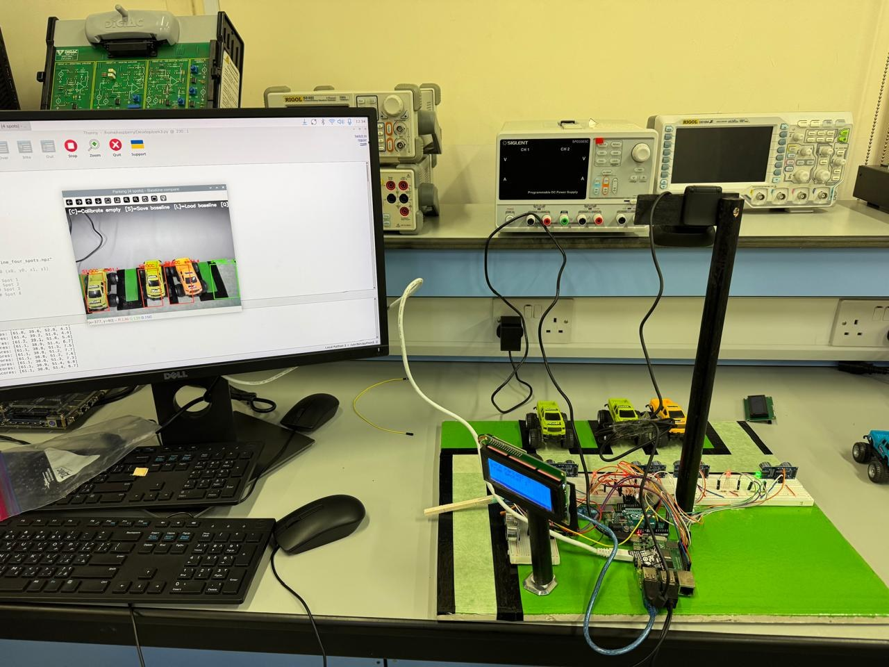
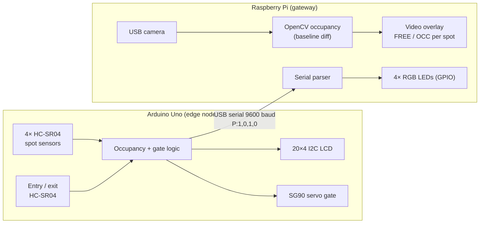
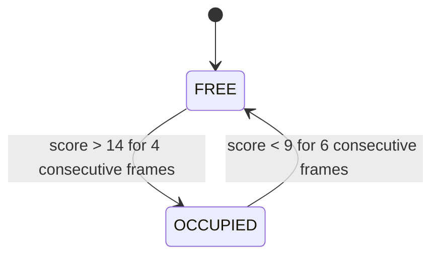
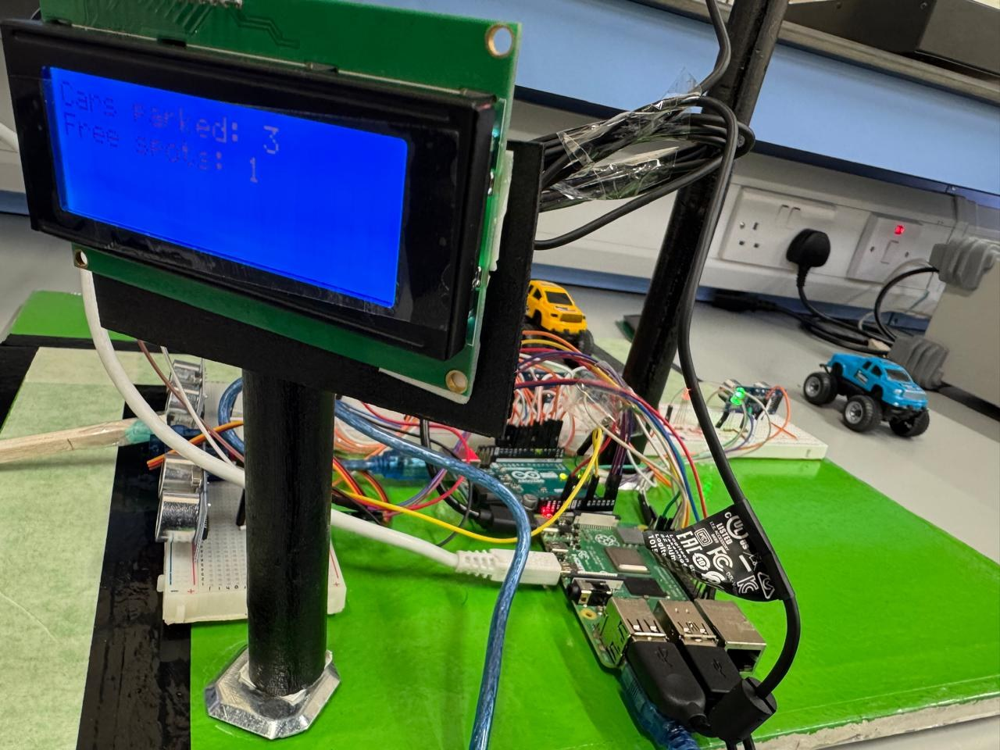

# Smart Parking: IoT + Edge Computer Vision

An Arduino + Raspberry Pi smart parking prototype. Ultrasonic sensors and a camera both detect when a spot is taken, a servo gate opens for arriving and leaving cars, and an LCD and per-spot LEDs show what's free.

<p align="center">
  
</p>

## Overview

Drivers waste time and fuel circling for parking because most lots give no real-time information about free spaces. This project is a low-cost, small-scale prototype of an automated lot. It detects occupancy per spot, controls an entry/exit barrier and shows live availability with no human in the loop.

The system uses a **two-tier edge architecture**. An Arduino Uno handles time-critical sensing and actuation. A Raspberry Pi acts as the gateway and runs a lightweight OpenCV pipeline that gives a second, camera-based reading of each spot's occupancy.

<p align="center">
  <br>
  <em>Prototype: 4-spot lot with ultrasonic sensors, overhead camera, servo gate, I2C LCD and Raspberry Pi.</em>
</p>

## Features

- **Per-spot occupancy sensing:** 4× HC-SR04 ultrasonic sensors (occupied if distance < 14 cm)
- **Automatic gate:** separate entry and exit sensors trigger an SG90 servo barrier (opens 3 s, re-arms once the car has moved away)
- **Live LCD:** 20×4 I2C display shows *Cars parked* / *Free spots* and only refreshes when the count changes
- **Arduino → Pi serial link:** compact `P:1,0,1,0` messages over USART at 9600 baud
- **Per-spot RGB LEDs** on the Pi GPIO: red = occupied, green = free
- **Camera-based detection (OpenCV):** baseline-difference scoring with EMA smoothing, hysteresis and frame debouncing to avoid flicker
- **Calibrate / save / load** an empty-lot baseline from the keyboard (`C` / `S` / `L`)

## How it works



**Arduino loop (~0.5 s):** read the four spot sensors, update the LCD if the count changed, check the entry/exit sensors and open the gate if needed, then send the occupancy string to the Pi.

**Camera pipeline (per frame, per spot):**

1. Grayscale + 5×5 Gaussian blur
2. Crop the spot's region of interest (ROI) and compute the mean absolute difference against the stored empty-lot baseline
3. Smooth the score with an exponential moving average (α = 0.2)
4. Change state with hysteresis and debouncing, as shown below:



The full system FSM and the hand-drawn wiring schematic from the project report are in [`docs/`](docs/).

### Wiring summary

| Component | Connected to | Pins |
|---|---|---|
| Spot sensors 1–4 (trig/echo) | Arduino | 2/3, 4/5, 6/7, 8/9 |
| Gate entry sensor (trig/echo) | Arduino | 10/11 |
| Gate exit sensor (trig/echo) | Arduino | 12/13 |
| SG90 servo | Arduino | A0 |
| 20×4 I2C LCD (0x27) | Arduino | SDA/SCL |
| Spot LEDs 1–4 (R/G) | Raspberry Pi (BCM) | 4/17, 27/22, 23/24, 20/21 |
| Arduino ↔ Pi | USB | `/dev/ttyACM0` |
| Camera | Raspberry Pi | USB (index 0), 1280×720 |

## Tech stack

**Hardware:** Arduino Uno, Raspberry Pi, HC-SR04 ultrasonic sensors ×6, SG90 servo, 20×4 I2C LCD, RGB LEDs, USB camera
**Firmware:** C++ (Arduino): `Servo`, `Wire`, `LiquidCrystal_I2C`
**Gateway:** Python 3, OpenCV, NumPy, pySerial, RPi.GPIO
**Protocols:** USART (USB serial), I2C

## Results

The system was evaluated with six functional tests on the physical prototype. Results are **qualitative pass/fail**. No quantitative metrics were recorded.

| Test | Acceptance criterion | Result |
|---|---|---|
| Parking spot detection | All 4 spots correctly detected; update within 1–2 s | Pass |
| Gate activation | Opens once per detection event and fully closes | Pass |
| LCD update | Correct counts; refreshes only when count changes (no flicker) | Pass |
| OpenCV vehicle detection | Overlay matches real occupancy and Arduino data | Pass |
| Arduino ↔ Pi communication | `P:x,x,x,x` received without corruption or delay | Pass |
| Full system integration | All modules work together with no conflicts | Pass |

<p align="center">
  <br>
  <em>Camera view: three spots detected as occupied (red), one free (green), with live difference scores.</em>
</p>

<p align="center">
  <br>
  <em>LCD showing live availability.</em>
</p>

## Installation and usage

### 1. Arduino firmware

1. Install the [Arduino IDE](https://www.arduino.cc/en/software).
2. Install the **LiquidCrystal I2C** library. `Servo` and `Wire` are built in.
   > The sketch calls `lcd.begin()` with no arguments. If your library version doesn't compile with that, replace it with `lcd.init();`.
3. Open `firmware/smart_parking/smart_parking.ino`, select **Arduino Uno** and the correct port, then **Upload**.
4. Optional check: open the Serial Monitor at 9600 baud. You should see lines like `P:0,1,0,0`.

### 2. Raspberry Pi gateway

```bash
git clone https://github.com/AbdelrahmanSotohy/smart-parking-iot-cv.git
cd smart-parking-iot-cv

# Option A – system packages (recommended on Raspberry Pi OS)
sudo apt update
sudo apt install -y python3-opencv python3-numpy python3-serial python3-rpi.gpio

# Option B – virtual environment
python3 -m venv --system-site-packages .venv
source .venv/bin/activate
pip install -r requirements.txt

# Allow serial access without sudo (log out/in afterwards)
sudo usermod -aG dialout $USER
```

Connect the Arduino over USB and the camera, then:

```bash
cd raspberry_pi
python3 parking_gateway.py
```

### 3. First-time calibration

1. Empty all four spots and press **C** to capture the baseline.
2. Press **S** to save it to `parking_baseline_four_spots.npz`. It loads automatically on the next run.
3. Park cars. Spots turn red in the video window, and the LEDs follow the ultrasonic readings.
4. Press **Q** to quit. GPIO and serial are released cleanly.

> ROIs are hard-coded for a 1280×720 frame (`ROI_BOXES` in `parking_gateway.py`). If you move the camera or change resolution, update the boxes and recalibrate.

## Project structure

```
smart-parking-iot-cv/
├── firmware/
│   └── smart_parking/
│       └── smart_parking.ino     # Arduino: sensors, gate, LCD, serial output
├── raspberry_pi/
│   └── parking_gateway.py        # Pi: serial → LEDs, OpenCV occupancy detection
├── docs/
│   ├── fsm_diagram.png           # System finite state machine
│   └── hardware_schematic.jpg    # Wiring schematic
├── assets/                       # README images and demo GIF
├── requirements.txt
├── LICENSE
└── README.md
```

## Limitations and future work

**Current limitations**
- **No sensor fusion yet.** LEDs follow the ultrasonic readings only. The camera state is shown on screen and printed next to the Arduino state in the console, but doesn't change any decision.
- **Classical CV, not learned.** Baseline differencing is sensitive to lighting changes and camera movement and needs manual recalibration. ROIs are fixed pixel boxes.
- **No quantitative evaluation.** Accuracy, latency and FPS were not measured.
- **Blocking gate logic.** `openGate()` uses `delay(3000)`, so sensors aren't read while the gate is open. Entry and exit share one servo.
- **No network layer.** Status is shown locally on the LCD, LEDs and Pi display, with no dashboard or remote access.

**Future work**
- **Fuse camera + ultrasonic** before driving the LEDs (e.g. agreement or confidence voting) and flag disagreements as sensor faults
- **Lightweight learned classifier** per ROI (e.g. a small CNN such as MobileNet trained on empty/occupied crops), quantized to INT8 with TFLite for on-device inference on the Pi, and benchmarked against the baseline method
- **Proper evaluation:** per-spot accuracy and F1 against labelled frames, CV–ultrasonic agreement rate, end-to-end latency, FPS and CPU/power on the Pi
- **Non-blocking firmware** (`millis()`-based state machine) and separate entry/exit barriers
- **Secure connectivity:** MQTT over TLS to a local or cloud dashboard, with device authentication
- Adaptive baseline to handle lighting drift; mobile app; rechargeable power supply

## Team and credits

Group project for **CEN425 – IoT: Applications & Networking**, Abu Dhabi University, Fall 2025.
Supervised by **Dr. Taimur Hassan** and **Eng. Leen Ba'ba'**.

**Team:** Abdelrahman Sotohy · Jouni Ilyas · Omar Aladawi

## Contact

**Abdelrahman Sotohy**: [LinkedIn](https://www.linkedin.com/in/abdelrahman-sotohy-6986b8369/)

## License

Released under the [MIT License](LICENSE).
